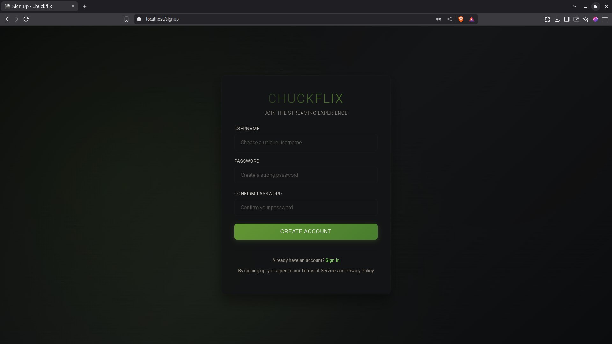
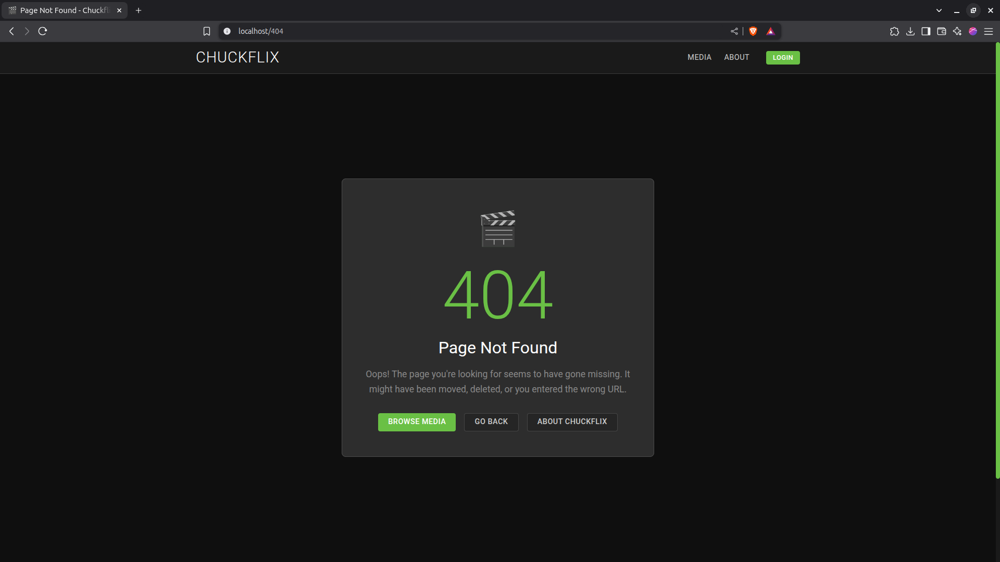
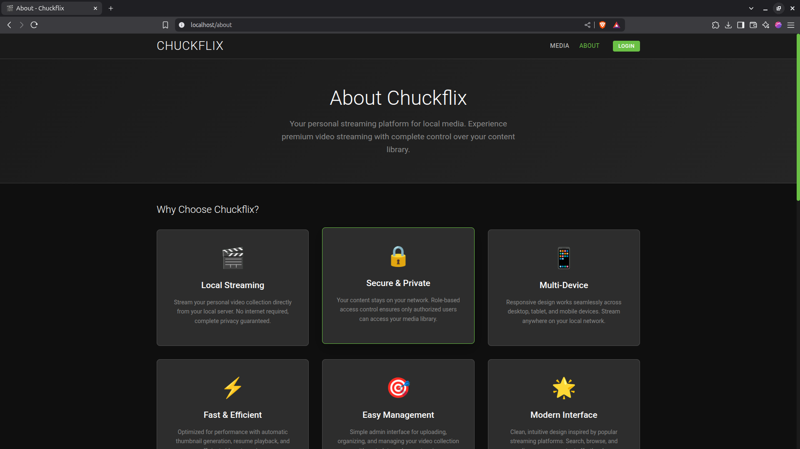
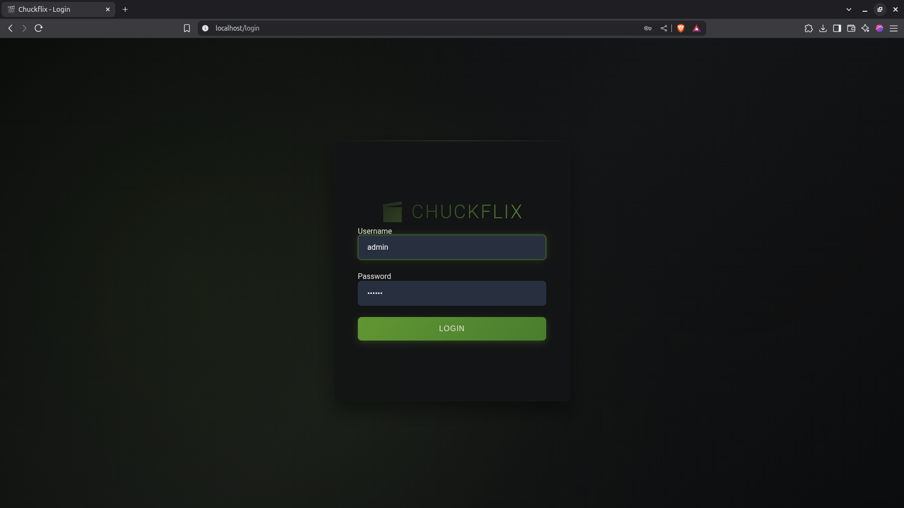
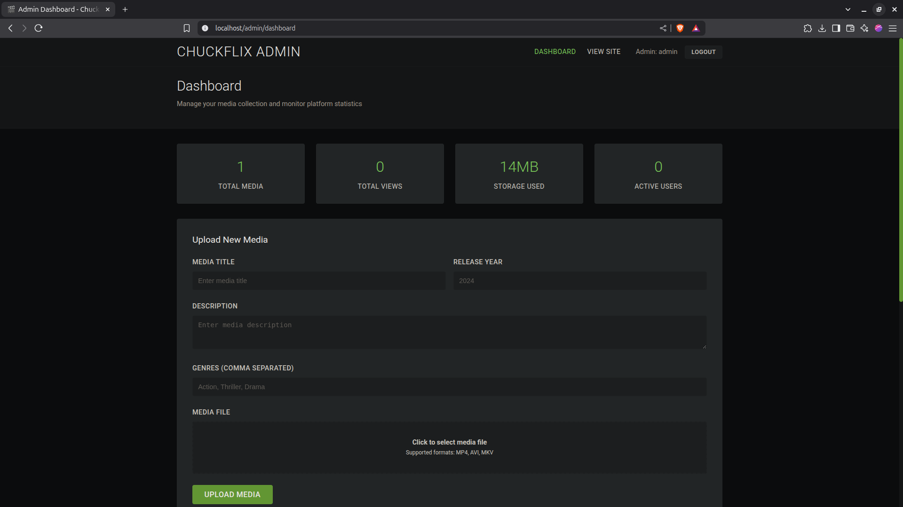
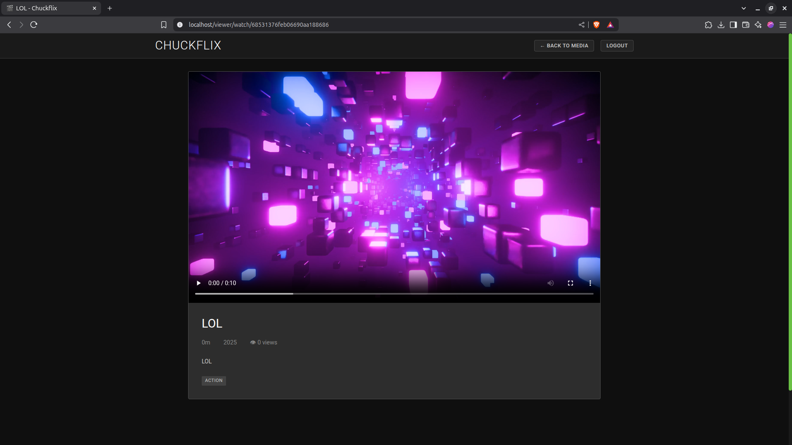
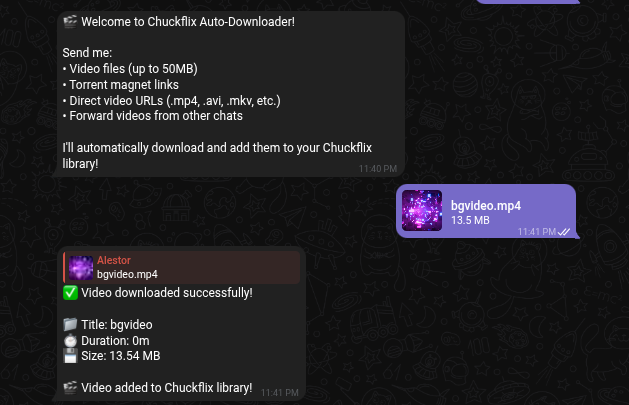

<div align="center">

# 🎬 Chuckflix 🎬

**Your personal streaming platform for local media. Experience premium video streaming with complete control over your content library.**

[Features](#features) -  [Installation](#installation) -  [Usage](#usage) -  [Configuration](#configuration) -  [Contributing](#contributing)

</div>

---

## 📋 Table of Contents

- [Overview](#overview)
- [Features](#features)
- [Tech Stack](#tech-stack)
- [Prerequisites](#prerequisites)
- [Installation](#installation)
- [Configuration](#configuration)
- [Running the Application](#running-the-application)
- [Admin Setup](#admin-setup)
- [Telegram Bot Setup](#telegram-bot-setup)
- [Usage Guide](#usage-guide)
- [File Structure](#file-structure)
- [API Documentation](#api-documentation)
- [Troubleshooting](#troubleshooting)
- [Contributing](#contributing)
- [License](#license)

---

## 🌟 Overview

Chuckflix is a comprehensive self-hosted streaming platform that provides complete control over your personal media library. Built with modern web technologies, it offers secure, private video streaming with an intuitive interface designed for seamless content management and viewing.

**Perfect for:**

- 🏠 Home media servers
- 🏢 Office presentation systems
- 🎓 Educational content distribution
- 🎮 LAN events and private networks

---

## ✨ Features

### 🎬 Local Streaming

Stream your personal video collection directly from your local server. No internet required, complete privacy guaranteed.

### 🔒 Secure \& Private

Your content stays on your network. Role-based access control ensures only authorized users can access your media library.

### 📱 Multi-Device

Responsive design works seamlessly across desktop, tablet, and mobile devices. Stream anywhere on your local network.

### ⚡ Fast \& Efficient

Optimized for performance with automatic thumbnail generation, resume playback, and efficient video streaming.

### 🎯 Easy Management

Simple admin interface for uploading, organizing, and managing your video collection with metadata and genre tagging.

### 🌟 Modern Interface

Clean, intuitive design for effortless content discovery. Search, browse, and discover your content with ease.

### 🤖 Telegram Bot Integration

- **Automatic video downloads** from multiple sources
- **Torrent support** (magnet links and .torrent files)
- **Direct video URL downloads**
- **Real-time progress tracking**
- **Automatic cleanup** of unnecessary files

---

## 🛠 Tech Stack

| Layer | Technology | Purpose |
| :-- | :-- | :-- |
| **Frontend** | HTML, EJS, CSS, JavaScript | Responsive UI with modern design |
| **Backend** | Node.js, Express.js | RESTful API and routing |
| **Database** | MongoDB | Video metadata and user management |
| **Authentication** | Express-session | Role-based access control |
| **File Processing** | FFmpeg, Multer | Video processing and uploads |
| **Bot Integration** | Telegram Bot API, WebTorrent | Automated downloads |


---

## 📋 Prerequisites

Before installing Chuckflix, ensure you have the following installed:

### Required Software

- **Node.js** (v16.0.0 or higher)
- **MongoDB** (v4.4 or higher)
- **FFmpeg**
- **Git**


### System Requirements

- **RAM:** Minimum 2GB (4GB recommended)
- **Storage:** At least 10GB free space
- **Network:** Local network access for streaming
- **OS:** Windows 10+, macOS 10.14+, or Linux 


### Verify Installation

```bash
# Check Node.js version
node --version

# Check MongoDB installation
mongod --version

# Check FFmpeg installation
ffmpeg -version

# Check Git installation
git --version
```


---

## 🚀 Installation

### Step 1: Clone the Repository

```bash
git clone https://github.com/yourusername/chuckflix.git
cd chuckflix
```


### Step 2: Install Dependencies

```bash
# Install Node.js dependencies
npm install

# Install additional dependencies for Telegram bot
npm install node-telegram-bot-api axios webtorrent
```


### Step 3: Create Required Directories

```bash
# Create upload directories
mkdir -p public/uploads/videos
mkdir -p public/uploads/thumbnails

# Create scripts directory
mkdir -p scripts

# Set proper permissions (Linux/macOS)
chmod 755 public/uploads/videos
chmod 755 public/uploads/thumbnails
```


### Step 4: Environment Configuration

Create a `.env` file in the root directory:

```env
# Database Configuration
MONGODB_URI=mongodb://localhost:27017/chuckflix

# Server Configuration
PORT=3000
NODE_ENV=development

# Session Secret (Change this to a random string)
SESSION_SECRET=your-super-secret-session-key-change-this

# Telegram Bot Configuration (Optional)
TELEGRAM_BOT_TOKEN=your-telegram-bot-token-here

# FFmpeg Configuration (Optional - if not in PATH)
FFMPEG_PATH=/usr/local/bin/ffmpeg
```


---

## ⚙️ Configuration

### MongoDB Setup

#### Option 1: Local MongoDB Installation

```bash
# Start MongoDB service
# On macOS with Homebrew:
brew services start mongodb/brew/mongodb-community

# On Linux (systemd):
sudo systemctl start mongod

# On Windows:
net start MongoDB
```


#### Option 2: MongoDB Atlas (Cloud)

1. Create account at MongoDB Atlas
2. Create a new cluster
3. Get connection string
4. Update `MONGODB_URI` in `.env` file

### FFmpeg Setup

#### Windows

1. Download FFmpeg from official website
2. Extract to `C:\ffmpeg`
3. Add `C:\ffmpeg\bin` to system PATH
4. Restart command prompt

#### macOS

```bash
# Using Homebrew
brew install ffmpeg

# Using MacPorts
sudo port install ffmpeg
```


#### Linux (Ubuntu/Debian)

```bash
# Update package list
sudo apt update

# Install FFmpeg
sudo apt install ffmpeg

# Verify installation
ffmpeg -version
```


---

## 🏃‍♂️ Running the Application

### Step 1: Start MongoDB

Ensure MongoDB is running on your system:

```bash
# Check if MongoDB is running
mongo --eval "db.adminCommand('ismaster')"
```


### Step 2: Create Admin User

```bash
# Run the admin creation script
npm run create-admin

# Or manually:
node scripts/createAdmin.js
```

**Default Admin Credentials:**

- Username: `admin`
- Password: `admin123`
- Email: `admin@chuckflix.local`


### Step 3: Start the Application

```bash
# Development mode with auto-restart
npm run dev

# Production mode
npm start
```


### Step 4: Access the Application

Open your web browser and navigate to:

- **Main Application:** http://localhost:3000
- **Admin Dashboard:** http://localhost:3000/admin/dashboard
- **Login Page:** http://localhost:3000/login

---

## 👤 Admin Setup

### Creating Additional Admin Users

#### Method 1: Using the Script

```bash
# Edit scripts/createAdmin.js to change credentials
node scripts/createAdmin.js
```


#### Method 2: Manual Database Entry

```javascript
// Connect to MongoDB shell
mongo chuckflix

// Create admin user
db.users.insertOne({
  username: "newadmin",
  email: "newadmin@chuckflix.local",
  password: "$2a$10$hashedPasswordHere", // Use bcrypt to hash
  role: "admin",
  createdAt: new Date()
});
```


### Admin Dashboard Features

#### Video Management

- **Upload videos** with metadata
- **Generate thumbnails** automatically
- **Organize by tags** and categories
- **Delete unwanted** content
- **View statistics** and analytics


#### User Management

- **View all users** and their roles
- **Monitor activity** and usage
- **Manage permissions** and access


#### System Settings

- **Configure upload limits**
- **Manage storage** and cleanup
- **Monitor system** performance

---

## 🤖 Telegram Bot Setup

### Step 1: Create Telegram Bot

1. **Start conversation** with @BotFather
2. **Send command:** `/newbot`
3. **Choose bot name:** e.g., "Chuckflix Downloader"
4. **Choose username:** e.g., "chuckflix_bot"
5. **Copy the token** provided by BotFather

### Step 2: Configure Bot Token

Add your bot token to the `.env` file:

```env
TELEGRAM_BOT_TOKEN=1234567890:ABCdefGHIjklMNOpqrsTUVwxyz
```


### Step 3: Start the Bot

The bot will automatically start when you run the main application:

```bash
npm start
```

Look for this message in the console:

```
🤖 Telegram bot initialized successfully
📱 Bot ready to receive videos, torrents, and URLs
```


### Step 4: Bot Usage

#### Supported Content Types

- **Video files** (up to 2GB via direct upload)
- **Magnet links** for torrent downloads
- **.torrent files** uploaded directly
- **Direct video URLs** (.mp4, .avi, .mkv, etc.)
- **Forwarded videos** from other chats


#### Bot Commands

```
/start - Initialize bot and show instructions
```


#### Usage Examples

```
# Send magnet link
magnet:?xt=urn:btih:example...

# Send direct video URL
https://example.com/video.mp4

# Upload .torrent file
[Upload .torrent file directly]

# Forward video from another chat
[Forward any video message]
```


---

## 📖 Usage Guide

### For Viewers

#### Signing Up

1. Navigate to http://localhost:3000/signup
2. Fill in required information
3. Account will be created as "Viewer" role
4. Automatic redirect to browse page

#### Browsing Content

- **Search videos** by title or tags
- **Filter by genre** using tag system
- **View video details** including duration and description
- **Resume playback** from where you left off


#### Watching Videos

- **Click any video** to start streaming
- **Use video controls** for playback management
- **Progress automatically saved** in browser storage
- **View count incremented** on completion


### For Administrators

#### Uploading Content

1. **Access admin dashboard** at `/admin/dashboard`
2. **Fill upload form** with video details
3. **Select video file** (supports multiple formats)
4. **Add tags and description** for better organization
5. **Submit form** and wait for processing

#### Managing Library

- **View all uploaded** videos in dashboard
- **Edit video metadata** and descriptions
- **Delete unwanted** content
- **Monitor storage** usage and statistics

---

## 📁 File Structure

```
chuckflix/
├── app.js                    # Main application entry point
├── bot/                      # Telegram bot integration
│   └── telegramBot.js       # Bot implementation for video downloads
├── createAdmin.js           # Admin user creation script
├── middleware/              # Custom middleware functions
│   └── auth.js             # Authentication middleware
├── models/                  # MongoDB data models
│   ├── User.js             # User schema and methods
│   └── Video.js            # Video metadata schema
├── package.json            # Node.js dependencies and scripts
├── package-lock.json       # Locked dependency versions
├── public/                 # Static assets and uploads
│   ├── css/               # Stylesheets
│   │   ├── login.css      # Login page styling
│   │   ├── signup.css     # Sign up page styling
│   │   └── style.css      # Main application styles
│   └── uploads/           # User uploaded content
│       ├── thumbnails/    # Generated video thumbnails
│       └── videos/        # Video files storage
├── README.md              # Project documentation
├── routes/                # Express route handlers
│   ├── admin.js          # Admin panel routes
│   ├── auth.js           # Authentication routes
│   ├── videos.js         # Video management routes
│   └── viewer.js         # Viewer routes and streaming
├── utils/                 # Utility functions
│   └── thumbnailGenerator.js # FFmpeg thumbnail generation
└── views/                 # EJS templates
    ├── 404.ejs           # Error page template
    ├── about.ejs         # About page template
    ├── admin/            # Admin interface templates
    │   └── dashboard.ejs # Admin dashboard
    ├── index.ejs         # Home page template
    ├── login.ejs         # Login page template
    ├── signup.ejs        # User registration template
    └── viewer/           # Viewer interface templates
        ├── browse.ejs    # Video browsing page
        └── watch.ejs     # Video player page
```


---

## 🔌 API Documentation

### Authentication Endpoints

#### POST `/login`

Login with username and password

```json
{
  "username": "admin",
  "password": "admin123"
}
```


#### POST `/signup`

Register new viewer account

```json
{
  "username": "newuser",
  "email": "user@example.com",
  "password": "password123",
  "confirmPassword": "password123"
}
```


#### POST `/logout`

Logout current user session

### Admin Endpoints

#### GET `/admin/dashboard`

Access admin dashboard (requires admin role)

#### POST `/admin/upload`

Upload new video content

```
Content-Type: multipart/form-data
Fields: title, description, tags, video (file)
```


#### POST `/admin/delete/:id`

Delete video by ID (requires admin role)

### Viewer Endpoints

#### GET `/viewer/browse`

Browse available videos with optional search

```
Query Parameters:
- search: Filter by title or tags
```


#### GET `/viewer/watch/:id`

Watch specific video by ID

#### GET `/viewer/stream/:filename`

Stream video file with range request support

#### POST `/viewer/increment-view/:id`

Increment view count for video

---

## 🐛 Troubleshooting

### Common Issues

#### MongoDB Connection Failed

```bash
# Check if MongoDB is running
sudo systemctl status mongod

# Start MongoDB service
sudo systemctl start mongod

# Check connection string in .env
MONGODB_URI=mongodb://localhost:27017/chuckflix
```


#### FFmpeg Not Found

```bash
# Install FFmpeg
sudo apt install ffmpeg  # Linux
brew install ffmpeg      # macOS

# Or specify path in .env
FFMPEG_PATH=/usr/local/bin/ffmpeg
```


#### Port Already in Use

```bash
# Find process using port 3000
lsof -i :3000

# Kill the process
kill -9 <PID>

# Or change port in .env
PORT=3001
```


#### File Upload Fails

```bash
# Check directory permissions
chmod 755 public/uploads/videos
chmod 755 public/uploads/thumbnails

# Check disk space
df -h

# Check file size limits in code
# Default: 500MB for torrents, 20MB for Telegram
```


#### Telegram Bot Not Working

```bash
# Verify bot token in .env
TELEGRAM_BOT_TOKEN=your_actual_token

# Check bot permissions with BotFather
# Ensure bot can receive files and messages

# Check WebTorrent initialization in logs
# Look for: "✅ WebTorrent initialized successfully"
```


---

## 📊 Platform Statistics

<div align="center">

| Metric | Value |
|--------|-------|
| **Local Control** | 100% |
| **Storage Capacity** | ∞ |
| **Availability** | 24/7 |

</div>

---

## 🎯 Perfect For

### 🏠 Home Media Server

Create your personal streaming platform at home. Stream movies, shows, and personal videos to any device on your network.

### 🏢 Office Presentations

Share training videos, presentations, and company content securely within your organization.

### 🎓 Educational Content

Distribute educational videos, lectures, and learning materials in schools, universities, or training centers.

---

## 🖼️ Demo

Below are screenshots demonstrating the Chuckflix interface:

| Screenshot | Description |
|------------|-------------|
|  | Signup screen |
|  | 404 Page |
|  |About page  |
|  | Admin dashboard |
|  | Login screen |
|  | Video player / Watch screen |
|  | Remote Download In Telegram |
 
---

## 🤝 Contributing

We welcome contributions to Chuckflix! Here's how you can help:

### Development Setup

1. **Fork the repository**
2. **Clone your fork**
```bash
git clone https://github.com/yourusername/chuckflix.git
```

3. **Create feature branch**
```bash
git checkout -b feature/amazing-feature
```

4. **Install dependencies**
```bash
npm install
```

5. **Make your changes**
6. **Test thoroughly**
7. **Commit changes**
```bash
git commit -m "Add amazing feature"
```

8. **Push to branch**
```bash
git push origin feature/amazing-feature
```

9. **Open Pull Request**

### Code Style

- Use **ESLint** for JavaScript linting
- Follow **Node.js best practices**
- Write **clear commit messages**
- Add **comments** for complex logic
- Update **documentation** for new features

---

## 📄 License

This project is licensed under the MIT License - see the [LICENSE](LICENSE) file for details.

---

## 🙏 Acknowledgments

- **FFmpeg** - Video processing capabilities
- **MongoDB** - Database solution
- **Node.js** - Runtime environment
- **Express.js** - Web framework
- **WebTorrent** - Torrent functionality

---

## 📞 Support

If you encounter any issues or have questions:

1. **Check the [Troubleshooting](#troubleshooting)** section
2. **Search existing Issues**
3. **Create a new Issue** with detailed information
4. **Join our community** for support

---

<div align="center">

**Made with ❤️ for the self-hosting community**

⭐ **Star this repo** if you find it useful!

</div>
